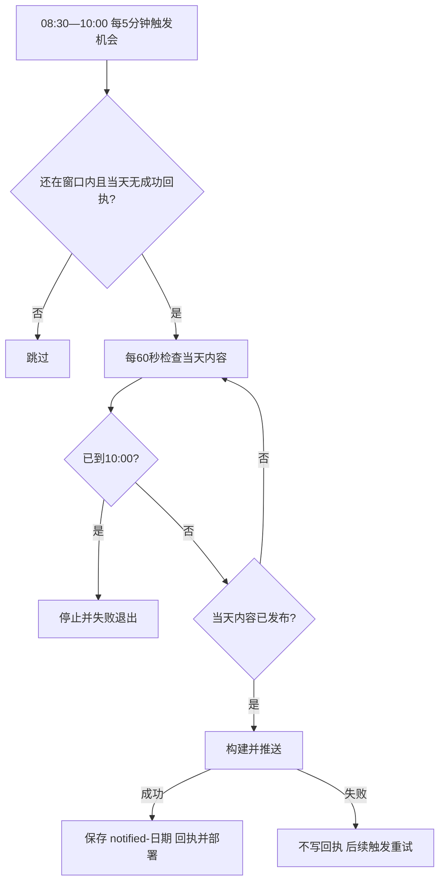

# AI 早报 · 私人阅读页

把 [橘鸦 AI 早报](https://daily.juya.uk) 的每日内容渲染成**移动端优先**的阅读页，并在每天早上推一条钉钉卡片。

不再依赖微信，也不再和钉钉的富文本限制较劲：**钉钉只负责叫你看，阅读交给网页。**

## 为什么这么做

- decohack 的 `/feed/` 只有 ProductHunt 版块，AI 日报没有独立 RSS；上游 `daily.juya.uk/rss.xml` 有全文 HTML，所以直接取上游。
- 钉钉自定义机器人的 markdown 是子集：表格/代码块渲染不出来、长消息会折叠。所以只推「标题 + 一句话」，全文走网页。
- 上游每期每条自带 `blockquote` 一句话摘要，正好用来做三级折叠的中间层。

## 阅读页做了什么

- 三级递进：**分节折叠 → 每条一句话 → 展开正文**
- 关注节默认展开，其余收起（`config.json` 里改）
- 一键「全部展开 / 收起全部」：分节和每条正文一起展/收，选择记在 localStorage，下次进来自动恢复
- 默认字号 14px（最小档），手机端隐藏装饰封面，为信息密度让路
- 移动优先、暗色模式、字号可调（都存在 localStorage）
- 移动端细节：正文图片懒加载、`safe-area-inset` 底部安全区、锚点跳转不被吸顶栏遮挡、回到顶部按钮、防电话号误识别、内联 favicon
- 顶部目录 chips、阅读进度条、封面图、视频版入口
- 往期归档页，每期固定 URL

## 本地跑

```bash
python3 build.py          # 抓取 + 生成 dist/
python3 build.py --offline  # 用 .cache 调试渲染
python3 notify.py --dry-run --force   # 只看要推的内容，不发送
open dist/index.html
```

## 配置

`config.json`：

| 字段 | 说明 |
|---|---|
| `site_base` | 部署后的站点根地址，用于拼推送里的链接 |
| `focus_sections` | 默认展开的分节，可选项：要闻 / 模型发布 / 开发生态 / 产品应用 / 技术与洞察 / 行业动态 / 前瞻与传闻 |
| `default_font_size` | 初始字号（页面里还能再调） |

## 推送通道

按环境变量自动选择：**配了飞书就发飞书，否则发钉钉。**

### 飞书（当前使用）

用**卡片 2.0 + 折叠面板**，7 个分节直接在卡片里展开阅读，不用跳浏览器：

- 关注节默认展开，其余收起，每个面板里是带序号的条目标题
- 底部「读全文」按钮才跳网页（全文 24 条 + 图片塞不进卡片，深读也需要排版和归档）
- 只有「读全文」这一个动作会离开飞书

配置：仓库 Settings → Secrets → Actions

| secret | 说明 |
|---|---|
| `FEISHU_WEBHOOK` | 群机器人 Webhook，`https://open.feishu.cn/open-apis/bot/v2/hook/...` |
| `FEISHU_SECRET` | 开启了「签名校验」才需要 |

加签算法是 `HMAC-SHA256(key="{timestamp}\n{secret}", msg=空)`，时间戳用**秒**——和钉钉正好相反（钉钉 key 是 secret、时间戳用毫秒），两套实现都在 `notify.py` 里。

### 钉钉（保留备用）

配 `DINGTALK_WEBHOOK` / `DINGTALK_SECRET` 即可切回，用 `actionCard` 类型。

### 幂等

只有最新一期是**当天**才会推。通知接口返回成功后保存 `notified-YYYY-MM-DD` Artifact（保留 7 天），当天后续运行检查到回执就跳过；失败不写回执，下次可重试。检查、发送和保存回执使用同一把并发锁，避免多个定时/手动任务同时发送。

手动测试用 `workflow_dispatch` 勾 `force_notify` 可忽略成功记录和内容日期；勾 `dry_run` 只打印，不保存成功记录。普通手动运行也遵守当天去重，但不受定时窗口限制。手动任务可能需要等待正在轮询的任务结束。

通知发送与 GitHub 回执保存不是一个事务：若消息已发送但回执上传失败，后续重试仍可能重复；不要删除当天回执。回执表示通知成功，后续 Pages 部署失败不会撤销回执。

### 卡片 2.0 的坑

`note`、`action` 这些 1.0 组件在 schema 2.0 里**已被移除**，用了会返回 `ErrCode 200861 unsupported tag`。摘要用 `markdown`，按钮用独立的 `button` 元素 + `behaviors: [{type: "open_url"}]`。

## 定时

每天按**北京时间 08:30（含）—10:00（不含）**执行：

- GitHub cron 在 08:30—10:00 每 5 分钟提供一次启动机会（平台最短支持 5 分钟）；后续触发不会取消正在执行的任务。
- 启动后每 60 秒轮询源站，发现当天内容就构建、推送，并记录当天成功状态。
- 成功后停止轮询；当天后续触发会跳过，不再发送通知。
- 10:00 仍未等到内容则失败退出；GitHub 延迟到 10:00 或以后才启动的定时任务直接跳过。发送通知前还会再检查时间，防止构建跨过截止时间后发送。



多次触发降低单次漏调度的影响，但 GitHub cron 不保证准时或必达；成功之后仍可能生成检查后跳过的运行记录。

## 目录

```
build.py            抓取 RSS → 解析 → 渲染静态页
notify.py           读 dist/latest.json → 推钉钉 actionCard
delivery_gate.py    检查执行窗口与当天推送成功回执
wait_for_today.py   每分钟等待当天内容，10:00 截止
config.json         站点与关注分节
.github/workflows/daily.yml   定时 + Pages 部署
dist/               生成物（不入库）
```
